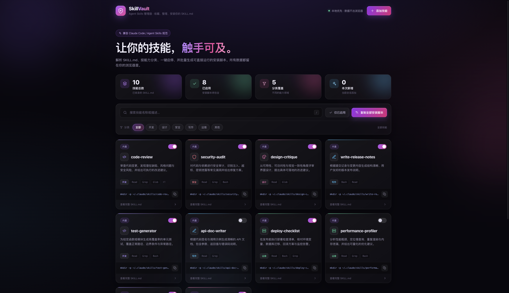

<div align="center">

[English](README.md) | [中文](README-zh.md)

🧰

# SkillVault — 本地 Agent Skills 管理器

▶ **[在线体验](https://webxiongda.github.io/skillvault/)** — 无需安装，直接在浏览器里运行。

一个面向 `SKILL.md` 收藏者的 local-first Agent Skills 管理器。解析 frontmatter、整理与启停技能、生成可直接运行的安装脚本——你的技能永远不会离开浏览器。

[](https://github.com/webxiongda/skillvault/stargazers)
[](https://github.com/webxiongda/skillvault/blob/main/LICENSE)
[](https://github.com/webxiongda/skillvault/pulls)
[](https://react.dev/)
[](https://www.typescriptlang.org/)

</div>

<div align="center">
  
</div>

## 为什么需要 SkillVault？

Agent Skills 已经成为给编码智能体提供可复用、任务专属指令的事实标准。`SKILL.md` 约定——一小段 YAML frontmatter 加上普通指令正文——设计上很简单，`mattpocock/skills` 与 Anthropic 的 `anthropics/skills` 等仓库也证明了共享技能库的价值。

格式简单，但管理不断增长的技能集合并不简单。技能散落在各种 gist、聊天记录和记不清的目录里。安装时要手写 `mkdir` 与 `cp` 命令，要记住哪些技能真正处于启用状态，还要祈祷复制粘贴的文件没有在某处被截断。

SkillVault 就是为这个集合准备的单页控制台。它在本地解析每一份 `SKILL.md`，为每个技能生成一张卡片，标明分类、来源与启用状态，并把已启用的技能集合转换成一段自包含的 bash 脚本，可直接复制或下载。没有后端、没有账号、没有遥测：浏览器就是整个产品。

## 特性

| 特性 | 说明 |
| --- | --- |
| Local-first 存储 | 技能、启停状态与偏好设置持久化在 `localStorage`；损坏的缓存数据会安全降级，不会阻塞启动。 |
| `SKILL.md` 解析器 | 校验必填的 `name` 与 `description`，读取可选的 `category` 与 `allowed-tools`；支持逗号分隔、`[...]` 数组、YAML `-` 列表以及 `>` / `|` 块标量。 |
| 添加时实时预览 | 左侧粘贴完整技能，右侧即时呈现解析后的卡片，并提供明确的错误提示与重复检测。 |
| 10 个内置技能 | `code-review`、`security-audit`、`design-critique`、`write-release-notes`、`test-generator`、`api-doc-writer`、`deploy-checklist`、`performance-profiler`、`refactor-assistant`、`accessibility-audit`。 |
| 卡片网格 + 详情抽屉 | 玻璃拟态卡片展示分类、来源与启用状态；点击可查看带行号的 `SKILL.md` 原文。 |
| 启用 / 禁用 | 每张卡片一个开关。禁用的技能会变暗、保留在技能库中，并从生成的安装脚本中排除。 |
| 批量安装脚本 | 带引号的 heredoc 将每份完整的 `SKILL.md` 写入 `~/.claude/skills/<name>/`。可选择仅已启用或全部技能，然后复制或下载 `.sh`。 |
| 搜索与筛选 | 即时的名称/描述搜索、分类标签，以及可组合关键词、分类、工具、来源与状态的高级表格。 |
| 导入 / 导出 | 带版本号的 JSON 备份，支持拖拽导入、校验预览，并对外部文件做防御性规范化。 |
| Hash 路由 | 10 个 `#/...` 路由，无路由依赖；相对路径与 iframe 嵌入均可使用。 |

**🔗 在线预览：** https://webxiongda.github.io/skillvault/

## 快速开始

```bash
git clone https://github.com/webxiongda/skillvault.git
cd skillvault && npm install
npm run dev
```

打开终端提示的地址（默认为 `http://localhost:5173`）即可使用。首次运行会自动加载 10 个示例技能。生产构建使用 `npm run build` 与 `npm run preview`。测试运行 `npm test`。

技能文件示例：

```markdown
---
name: my-skill
description: 用一句话说明这个技能做什么，以及何时使用它。
allowed-tools: Read, Grep, Bash
---

# My Skill

frontmatter 之后写具体指令……
```

`name` 与 `description` 必填；`name` 只允许字母、数字、连字符与下划线，且以字母或数字开头。`category` 与 `allowed-tools` 可选。分类为 `开发`、`设计`、`安全`、`写作`、`运维`、`其他`；省略 `category` 时会根据名称与描述通过关键词规则自动推断。

## 页面

应用使用 hash 路由，因此每个页面都有可直接分享的 URL。

| Hash | 页面 | 作用 |
| --- | --- | --- |
| `#/vault` | 技能库 | 全部技能的卡片网格，含统计、搜索、分类筛选、快速粘贴与可复制的安装命令。 |
| `#/add` | 添加技能 | 粘贴完整的 `SKILL.md`，实时解析、校验并左右对照预览。 |
| `#/enabled` | 已启用 | 仅展示参与安装脚本的技能；可切换开关并一键复制脚本。 |
| `#/categories` | 分类浏览 | 按能力领域分组，可折叠展开地浏览技能。 |
| `#/scripts` | 安装脚本 | 生成、预览、复制或下载自包含的批量安装脚本。 |
| `#/search` | 高级搜索 | 在结果表格中组合关键词、分类、允许工具、来源与启停状态筛选。 |
| `#/import-export` | 导入导出 | 下载 JSON 备份，或导入文件并先预览校验结果。 |
| `#/guide` | 使用指南 | 介绍 Agent Skill 概念、frontmatter 规则、Claude Code 与 Codex 的安装路径，以及四步玩法。 |
| `#/about` | 关于与热点 | 项目原则、技术选型、社区热点数据与授权说明。 |
| `#/settings` | 设置 | 默认分类、来源显示、卡片密度、存储占用与技能库重置。 |

## 工作原理

`parseSkillMarkdown` 从粘贴的 `SKILL.md` 中读取 YAML frontmatter，处理带引号的值、YAML 列表与折叠/保留换行块标量，校验 `name` 与 `description` 后生成带类型的技能记录。所有状态——用户技能、启停状态与偏好设置——都存放在带版本号的 `localStorage` 键中，采用容错读取，因此坏数据只会降级为空值，不会让应用崩溃。`buildInstallScript` 生成 bash 文件，先创建每个技能目录，再用带引号的 heredoc（`<<'SKILLVAULT_EOF'`）写入完整的 `SKILL.md`，正文中的 `$` 与反引号不会被 shell 展开。导航由一个轻量的 hash 路由钩子实现，导入导出则使用带版本号的 JSON 载荷并做结构校验。

## 技术栈

- React 19 + TypeScript 5.7，基于 Vite 6，并开启 `strict`、`noUnusedLocals` 与 `noUnusedParameters`。
- 原生 CSS —— 深色主题、渐变、玻璃拟态卡片与响应式布局；图标均为手写内联 SVG。
- 零额外运行时依赖：浏览器端只有 `react` 与 `react-dom`。

## 文档

- [English README](README.md) —— 本指南的英文原版。
- [Contributing](CONTRIBUTING.md) —— 如何在本地运行与提交 PR。
- [License](LICENSE) —— MIT。

## 贡献

欢迎提交 Pull Request。适合上手的 good first issue 包括：补充示例技能、完善解析器的 frontmatter 覆盖面、扩展筛选能力、改进导入导出流程。较大的改动请先开 issue 讨论，保持 local-first 约束不变，并遵循 [CONTRIBUTING.md](CONTRIBUTING.md) 中的约定。

## 路线图

- [ ] 支持更多其他智能体使用的 frontmatter 字段。
- [ ] 增加技能版本管理与备份之间的差异对比。
- [ ] 提供可作为 JSON 集合导入的精选技能包。
- [ ] 改善卡片网格的无障碍体验与键盘导航。
- [ ] 为希望将技能保存在浏览器之外的用户提供可选的文件系统同步。

## 授权

[MIT](LICENSE) © 2026 SkillVault contributors.
