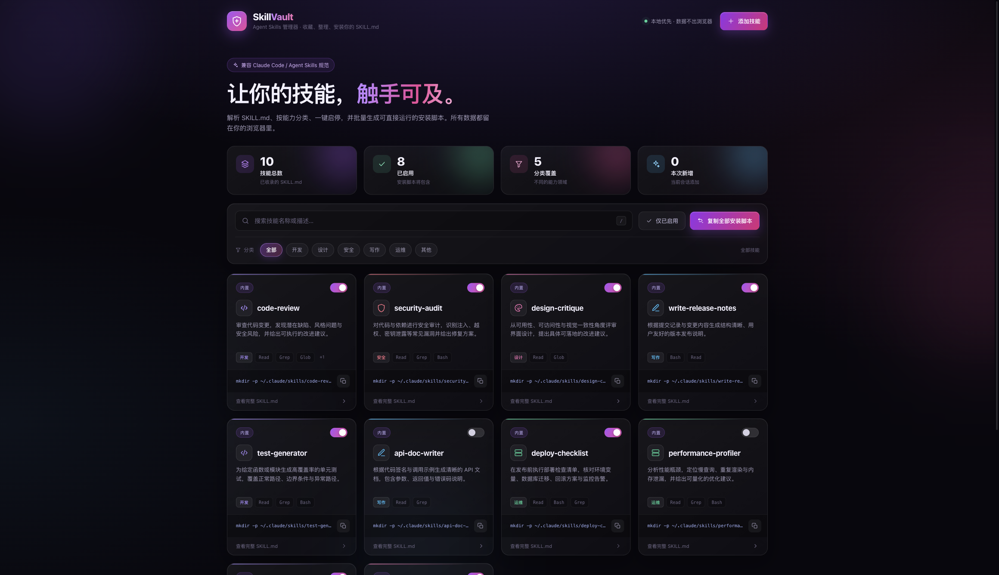

<div align="center">

[English](README.md) | [中文](README-zh.md)

🧰

# SkillVault

A local-first Agent Skills manager for people who collect `SKILL.md` files. Parse frontmatter, organize and toggle skills, and generate ready-to-run install scripts — your skills never leave the browser.

[](https://github.com/webxiongda/skillvault/stargazers)
[](https://github.com/webxiongda/skillvault/blob/main/LICENSE)
[](https://github.com/webxiongda/skillvault/pulls)
[](https://react.dev/)
[](https://www.typescriptlang.org/)

</div>

<div align="center">
  
</div>

## Why SkillVault?

Agent Skills have become the de facto way to give coding agents reusable, task-specific instructions. The `SKILL.md` convention — a small YAML frontmatter block followed by plain instructions — is simple by design, and repositories such as `mattpocock/skills` and Anthropic's `anthropics/skills` have shown how useful a shared skill library can be.

The format is simple; keeping track of a growing collection is not. Skills end up scattered across gists, chat threads, and directories you half-remember. Installing them means hand-writing `mkdir` and `cp` commands, recalling which ones are actually active, and hoping a copy-pasted file wasn't truncated along the way.

SkillVault is a single-page console for that collection. It parses every `SKILL.md` locally, gives each skill a card with its category, source, and enabled state, and turns the enabled set into one self-contained bash script you can copy or download. There is no backend, no account, and no telemetry: the browser is the whole product.

## Features

| Feature | Description |
| --- | --- |
| Local-first storage | Skills, enabled states, and preferences persist in `localStorage`; malformed cached data falls back safely instead of blocking startup. |
| `SKILL.md` parser | Validates required `name` and `description`, reads optional `category` and `allowed-tools`; accepts comma lists, `[...]` arrays, YAML `-` lists, and `>` / `|` block scalars. |
| Live add preview | Paste a full skill on the left and see the parsed card on the right, with actionable errors and duplicate detection. |
| Ten built-in skills | `code-review`, `security-audit`, `design-critique`, `write-release-notes`, `test-generator`, `api-doc-writer`, `deploy-checklist`, `performance-profiler`, `refactor-assistant`, `accessibility-audit`. |
| Card grid + detail drawer | Glassmorphism cards show category, source, and enabled state; click through to a line-numbered view of the raw `SKILL.md`. |
| Enable / disable | One toggle per card. Disabled skills dim out, stay in the library, and are excluded from generated install scripts. |
| Batch install scripts | A quoted heredoc writes each complete `SKILL.md` into `~/.claude/skills/<name>/`. Scope to enabled or all skills, then copy or download the `.sh`. |
| Search and filters | Instant name/description search, category chips, and an advanced table combining keyword, category, tool, source, and status. |
| Import / export | Versioned JSON backups with drag-and-drop import, validation preview, and defensive normalization of external files. |
| Hash routing | Ten `#/...` routes, no router dependency; works from relative paths and inside iframes. |

## Quick Start

```bash
git clone https://github.com/webxiongda/skillvault.git
cd skillvault && npm install
npm run dev
```

Open the address printed in the terminal (by default `http://localhost:5173`). Ten example skills are loaded on first run. For a production build, run `npm run build` and `npm run preview`.

A skill file looks like this:

```markdown
---
name: my-skill
description: One sentence on what this skill does and when to use it.
allowed-tools: Read, Grep, Bash
---

# My Skill

Instructions go here, after the frontmatter.
```

`name` and `description` are required; `name` accepts letters, digits, hyphens, and underscores, starting with a letter or digit. `category` and `allowed-tools` are optional. Categories are `开发`, `设计`, `安全`, `写作`, `运维`, and `其他`; when `category` is omitted, it is inferred from the name and description using keyword rules.

## Pages

The app uses hash routing, so every page has a shareable URL.

| Hash | Page | What it does |
| --- | --- | --- |
| `#/vault` | Vault | Card grid of all skills with stats, search, category filter, quick paste, and copyable install commands. |
| `#/add` | Add skill | Paste a complete `SKILL.md` with live parsing, validation, and side-by-side preview. |
| `#/enabled` | Enabled | Active skills only; toggles and one-click copy of the install script for the enabled set. |
| `#/categories` | Categories | Browse skills grouped by domain in collapsible sections. |
| `#/scripts` | Install script | Generate, preview, copy, or download the self-contained batch install script. |
| `#/search` | Advanced search | Combine keyword, category, allowed tool, source, and status filters in a result table. |
| `#/import-export` | Import / export | Download a JSON backup or import one with a validation preview. |
| `#/guide` | Guide | What an Agent Skill is, frontmatter rules, install paths for Claude Code and Codex, and a four-step walkthrough. |
| `#/about` | About & signals | Project principles, tech choices, community signals, and license notes. |
| `#/settings` | Settings | Default category, source visibility, card density, storage size, and library reset. |

## How it works

`parseSkillMarkdown` reads the YAML frontmatter from a pasted `SKILL.md`, handling quoted values, YAML lists, and folded/literal block scalars, then validates `name` and `description` before producing a typed skill record. All state — user skills, enabled states, and preferences — lives under versioned `localStorage` keys with tolerant reads, so bad cache entries degrade to empty values rather than crashing the app. `buildInstallScript` emits a bash file that creates each skill directory and uses a quoted heredoc (`<<'SKILLVAULT_EOF'`) to write the full `SKILL.md`, so `$` and backticks in the content are never expanded by the shell. Navigation is a small hash-route hook, and import/export uses a versioned JSON payload with schema checks.

## Tech Stack

- React 19 and TypeScript 5.7 under Vite 6, with `strict`, `noUnusedLocals`, and `noUnusedParameters` enabled.
- Vanilla CSS — dark theme, gradients, glassmorphism cards, and responsive layout; icons are hand-written inline SVG.
- Zero additional runtime dependencies: only `react` and `react-dom` ship to the browser.

## Documentation

- [中文说明](README-zh.md) — Chinese translation of this guide.
- [Contributing](CONTRIBUTING.md) — how to run locally and open a pull request.
- [License](LICENSE) — MIT.

## Contributing

Pull requests are welcome. Good first issues include adding example skills, improving the parser's frontmatter coverage, extending filters, and smoothing the import/export flow. Please open an issue for larger changes before you start, keep the local-first constraint intact, and follow the conventions in [CONTRIBUTING.md](CONTRIBUTING.md).

## Roadmap

- [ ] Support additional frontmatter fields used by other agents.
- [ ] Add skill versioning and diffing between imported backups.
- [ ] Offer curated skill packs as importable JSON collections.
- [ ] Improve accessibility and keyboard navigation across the card grid.
- [ ] Add optional filesystem sync for users who want skills outside the browser.

## License

[MIT](LICENSE) © 2026 SkillVault contributors.
